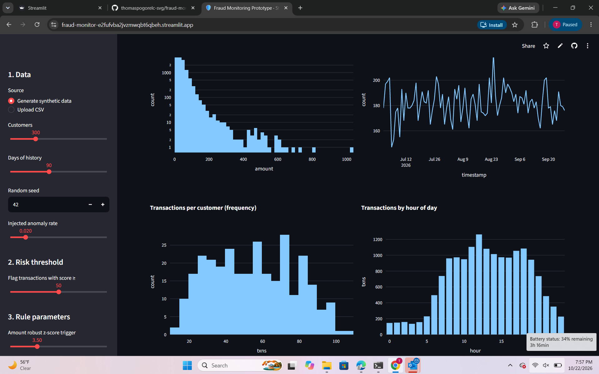
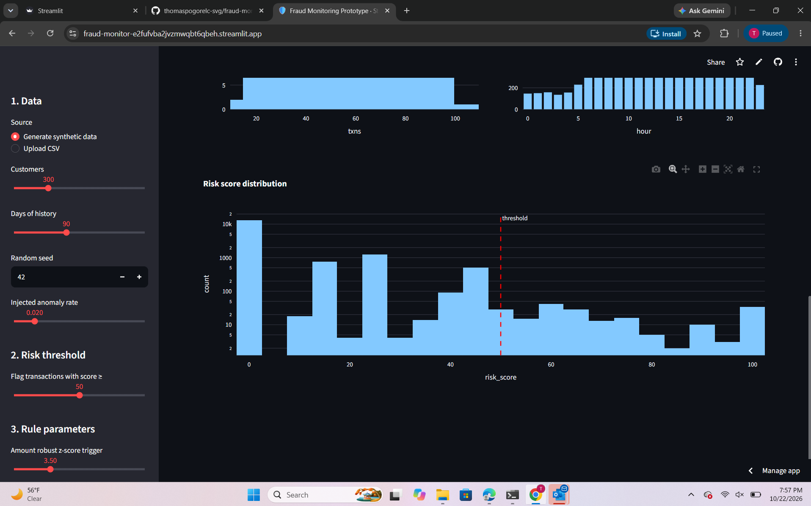

# Transaction Fraud Monitoring Prototype

An interactive Streamlit app that scores card transactions with a transparent, rule-based fraud risk model, flags
those above a user-chosen threshold, and explains every flag in plain English.
(Assignment option: **Project 9 – Financial Fraud and Transaction Monitoring Prototype**.)

> **Synthetic data only.** No real customer or banking data is used. Alerts indicate *anomalies*, not confirmed fraud.

## Financial problem

Banks and payment processors must screen huge volumes of transactions and send only a small number of suspicious
ones to human analysts. This app shows the core trade-off: a lower threshold catches more fraud but creates more
false alarms for analysts to review.

## Features

- Generates a reproducible synthetic dataset (customers, amounts, categories, countries, timestamps) with injected
  anomalies, **or** loads your own CSV.
- Pattern charts: amount distribution, daily volume, transactions per customer (frequency), hourly activity, risk-score distribution.
- Five-rule risk score (0–100) with editable parameters and weights.
- User-defined risk threshold; flagged table (downloadable CSV).
- Per-transaction explanation and a chart of points contributed by each rule.
- Evaluation tab: precision / recall / F1 against the synthetic labels, with a threshold sweep.
- Error handling: bad CSVs, missing columns, invalid values, and empty data show messages instead of crashing.

## Data

| Source | Details |
|---|---|
| Synthetic generator (`data_gen.py`) | Seeded, so results are reproducible. Normal behaviour is per-customer log-normal amounts with daytime-weighted hours. Injected anomalies: very large amounts, rapid bursts of purchases, and foreign-country night-time purchases in high-risk categories. About 0.7% of normal transactions are legitimate-but-large, so the rules are not trivially perfect. |
| Your own CSV (optional) | Required columns: `txn_id, customer_id, timestamp, amount, merchant_category, country`. An optional `synthetic_fraud_label` (0/1) column enables the Evaluation tab. |

No external API is required, so no API keys are needed. Never commit keys or real customer data to the repository.

## Run it

```bash
git clone <your-repo-url>
cd fraud-monitor
python -m venv .venv && source .venv/bin/activate      # Windows: .venv\Scripts\activate
pip install -r requirements.txt
streamlit run app.py
```

Run the tests: `python -m pytest -q`
Write a sample CSV: `python data_gen.py` (creates `sample_transactions.csv`)

## Financial concepts and calculations

1. **Robust amount outlier (median / MAD z-score).** Each transaction is compared with that customer's own median
   spend: `z = 0.6745 × (amount − median) / max(MAD, 10% of median, 1)`. Median/MAD resists distortion from the very
   outliers we are trying to find.
2. **Velocity.** Count of the customer's transactions within a rolling time window (default 60 min).
3. **Geography.** Country differs from the customer's most common country.
4. **Unusual hour.** Transaction falls in a configurable window (default 00:00–05:59).
5. **High-risk category.** Crypto, gambling, wire transfer, gift cards (more points when the amount is also large).
6. **Risk score** = sum of (rule intensity × rule weight), capped at 100. Intensities are 0, 0.5 or 1.
7. **Precision, recall, F1** and the **threshold trade-off** (false positives vs. missed fraud).

## Known limitations

- Data is synthetic; real fraud is more varied and adversarial.
- Customer baselines use each customer's full history, including the transaction being scored (a production system
  would use only prior history).
- Rules and default weights are hand-set, not learned; default weights were chosen by inspecting results on the
  synthetic data, so the evaluation metrics are optimistic and illustrative only.
- Customers with very few transactions have unreliable baselines.
- No real-time streaming, case management, or machine-learning model.

## How the AI coding agent was used

Claude Code was used to plan the project, write the scoring engine (`fraud.py`), synthetic data generator
(`data_gen.py`), Streamlit UI (`app.py`) and unit tests (`test_fraud.py`), and then to iterate: failing tests exposed
a pandas type-strictness issue in a test and revealed that the first default weights gave only ~18% recall at the
default threshold, so the weights were retuned. All outputs should be reviewed and understood by the author before submission.

## Screenshots

Add at least two screenshots of the running app in `screenshots/` (for example the **Patterns** tab and the
**Flagged transactions** tab) and reference them here:

```


```

## Project layout

```
app.py             Streamlit interface
fraud.py           Validation, feature engineering, scoring, evaluation
data_gen.py        Synthetic transaction generator
test_fraud.py      Unit tests
requirements.txt   Dependencies
```
